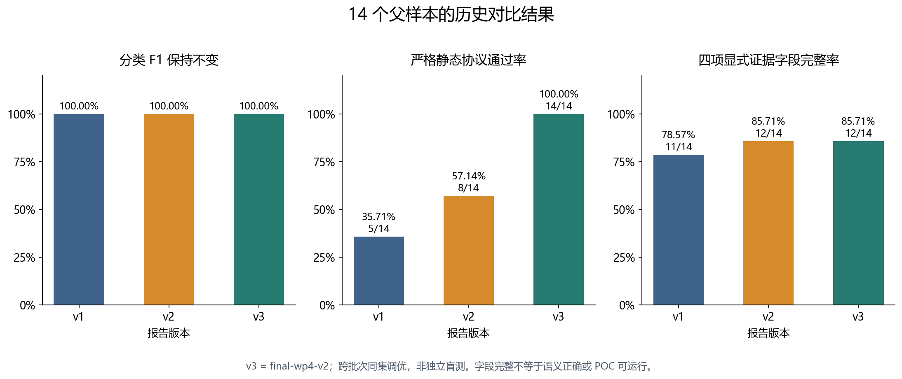
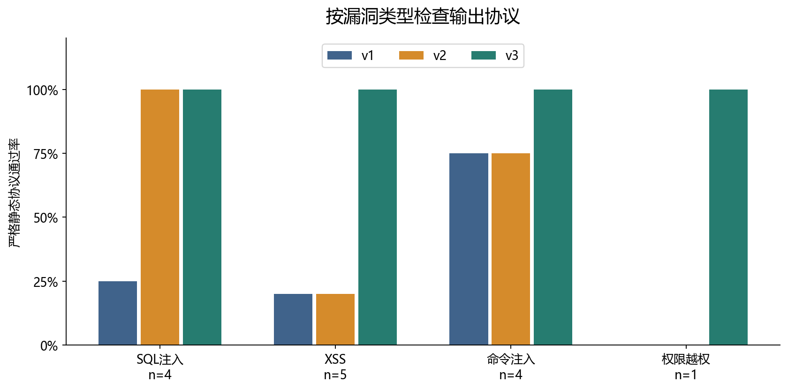
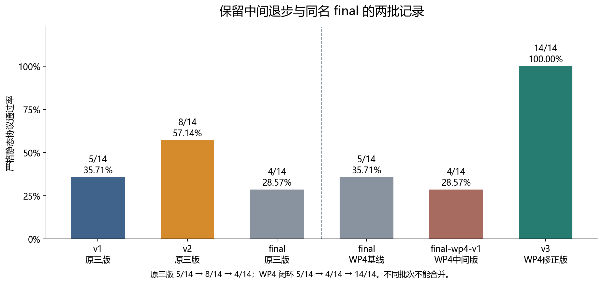
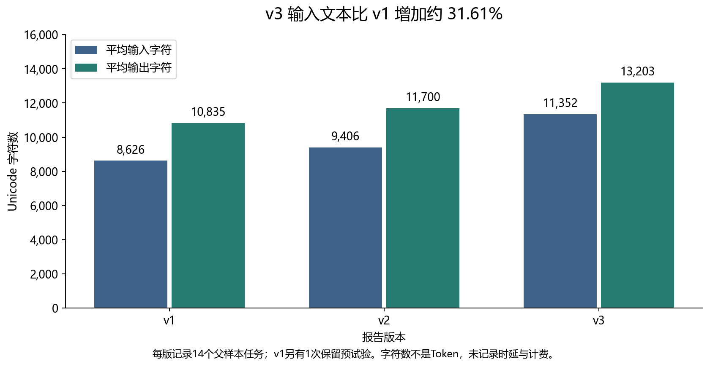

# 选做1 多版本 Prompt 挖掘效果对比报告

本实验比较同一组14个父样本在三个 Prompt 版本下的漏洞分类、证据完整性、输出协议与文本成本。三版与项目已有主条件标签均完全一致，分类精确率、召回率和 F1 没有提高；严格静态协议通过率由 v1 的35.71%上升至 v3 的100.00%，四项显式证据字段完整率由78.57%上升至85.71%。补测40份原稿后，POC可运行率为 v1 13/14（92.86%）、v2 11/13（84.62%）、v3 13/13（100.00%）。这些结果支持已知样本上的输出约束改善和 v3 的原稿可运行性提升，但仍受同集调优与样本量限制，不能外推为泛化能力。

**交付状态：历史证据分析、可复现材料与40份原稿补测已完成。** 历史时延、Token及具体采样参数无法追溯；原始标签的预先冻结时间与人工独立复核仍不足。因此成本项保持“未记录”，POC结果只代表本机固定靶场、原稿未改代码的执行情况。

## 1 项目基线与版本选择

基线为用户提供的完整项目 ZIP，与 GitHub main 提交 `533b87dd1225d6bd11cb8bdc98b0f2f91eb69617` 的706个文件逐一核对一致。归档 SHA-256 为 `5de86d0de9be93aed2308d557d5322a8960bde423fa82d6af5f7ec63e549f200`。历史模型记录日期为2026年10月19日；本次离线复算日期为2026年10月20日。本次没有重新调用模型，也没有把旧会话草案视为新实验。

| 报告代号 | 实际 Prompt 版本 | 历史批次 | 版本作用 |
| --- | --- | --- | --- |
| v1 | v1 | wp2-eval-42 | 通用基线，已有统一输出协议 |
| v2 | v2 | wp2-eval-42 | 加强逐字证据、成立条件与漏洞专属规则 |
| v3 | final-wp4-v2 | wp4-final-wp4-v2 | 纳入主体 POC 反馈，补齐可观测性、严格类型与排除证据约束 |

v3 是报告代号，源文件与输出里的版本名保持 `final-wp4-v2`。原三版中的 `final` 尚未纳入后续工作包4反馈，不直接改名为 v3。为避免只展示最优版本，补充保留原 `final`、工作包4的 `final` 基线和 `final-wp4-v1` 中间版；合计复算84份历史响应，其中主比较42份。

完整 Prompt 汇编见 [v1](prompts/v1.md)、[v2](prompts/v2.md)、[v3](prompts/v3.md)，逐包原件见 `raw_inputs/`。逐字节来源和哈希见 [输入清单](input_manifest.csv) 与 [来源核对](source_hash_audit.csv)。

## 2 实验条件与计数口径

样本为工作包1输入 v2，含14个父样本、17份输入包。逐包提取审计数据区并计算 SHA-256，六个比较组的17个数据区全部一致。SQLI-005与AUTH-001的多包只汇总为一个父样本，不重复计数。

真实标签取 `results/batches/wp4-poc-01/ground_truth.csv` 的14条 `main_condition=yes` 记录，共12个阳性、2个阴性。17条条件验证全部保留供追溯，但AUTH-001的四个配置不能算成四个独立父样本。父样本主标签为low条件下存在漏洞，不代表impossible配置也存在漏洞。

历史模型名称均记为 DeepSeek Harness subagent（deepseek-flash），每条结果在独立子代理上下文生成，多包一次性提供。具体服务端快照、温度、最大输出长度、工具权限与内部调用次数无法核验；不同版本来自历史批次，不能声称严格随机受控或完全同参。任务不要求商业API，关键限制是实际参数与过程记录缺失。

预测“存在候选”记阳性，“未检出候选”记阴性，“无法判定”记U并报告覆盖率。精确率=TP/(TP+FP)，召回率=TP/(TP+FN)，F1=2TP/(2TP+FP+FN)。分母为零记不适用，未知实测结果记待测。

证据完整率采用保守、可复算的字段口径：一份父样本响应的所有候选均具有非空位置、数据流、前置条件，且响应含有效结论状态，才计完整。两个阴性响应采用排除证据结构，没有显式 `data_flow` 与 `preconditions` 字段，计为字段不齐；这不表示其排除判断错误。字段齐全不等于数据流语义或行号正确，后者需另行核验。

## 3 整体结果

| 指标 | v1 | v2 | v3 |
| --- | --- | --- | --- |
| 精确率 | 100.00%（12/12） | 100.00%（12/12） | 100.00%（12/12） |
| 召回率 | 100.00%（12/12） | 100.00%（12/12） | 100.00%（12/12） |
| F1 | 100.00%（24/24） | 100.00%（24/24） | 100.00%（24/24） |
| 严格静态协议 | 35.71%（5/14） | 57.14%（8/14） | 100.00%（14/14） |
| 四项证据字段完整率 | 78.57%（11/14） | 85.71%（12/14） | 85.71%（12/14） |
| Python 语法通过率 | 100.00%（14/14） | 100.00%（13/13） | 100.00%（13/13） |
| POC 原稿可运行率 | 92.86%（13/14） | 84.62%（11/13） | 100.00%（13/13） |

每版 TP=12、FP=0、FN=0、TN=2、U=0。TP样本为AUTH-001、CMD-001/002/003、SQLI-001/002/003/005、XSS-001/002/003/005；TN为CMD-004与XSS-004。FP/FN集合为空，不能虚构代表性误报漏报。逐条判断见 [标注表](labeled_results.csv)。

v1到v2的严格协议通过率增加21.43个百分点；v2到v3增加42.86个百分点；v1到v3增加64.29个百分点，相对增加180.00%。证据字段完整率提高7.14个百分点，相对增加9.09%。精确率、召回率与F1变化均为0个百分点。差值使用原始分数计算后四舍五入，不用显示值相减。

v1的AUTH-001有一个finding缺少 `data_flow` 字段，没有满足统一证据字段要求，因此v1阳性证据字段完整为11/12；v2与v3为12/12。阴性的字段结构差异使整体比例分别为11/14、12/14、12/14。

### 分漏洞类型结果

| 类型 | 版本 | n | TP | FP | FN | TN | F1 | 严格协议 |
| --- | --- | --- | --- | --- | --- | --- | --- | --- |
| SQL注入 | v1 | 4 | 4 | 0 | 0 | 0 | 100.00% | 25.00% |
| SQL注入 | v2 | 4 | 4 | 0 | 0 | 0 | 100.00% | 100.00% |
| SQL注入 | v3 | 4 | 4 | 0 | 0 | 0 | 100.00% | 100.00% |
| XSS | v1 | 5 | 4 | 0 | 0 | 1 | 100.00% | 20.00% |
| XSS | v2 | 5 | 4 | 0 | 0 | 1 | 100.00% | 20.00% |
| XSS | v3 | 5 | 4 | 0 | 0 | 1 | 100.00% | 100.00% |
| 命令注入 | v1 | 4 | 3 | 0 | 0 | 1 | 100.00% | 75.00% |
| 命令注入 | v2 | 4 | 3 | 0 | 0 | 1 | 100.00% | 75.00% |
| 命令注入 | v3 | 4 | 3 | 0 | 0 | 1 | 100.00% | 100.00% |
| 权限越权 | v1 | 1 | 1 | 0 | 0 | 0 | 100.00% | 0.00% |
| 权限越权 | v2 | 1 | 1 | 0 | 0 | 0 | 100.00% | 0.00% |
| 权限越权 | v3 | 1 | 1 | 0 | 0 | 0 | 100.00% | 100.00% |

SQL注入与权限类没有阴性样本，不能据此评估这些类型的误报率；权限类仅一个父样本，结论非常有限。总体仅两个阴性，不能把0/2外推为实际误报率为零。

## 4 中间版本与错误分析

原三版 v1/v2/final 严格协议分别为5/14、8/14、4/14；工作包4闭环 final/final-wp4-v1/final-wp4-v2 分别为5/14、4/14、14/14。两批同名final是不同历史输出，必须分开。提示词更长并未带来单调改善，中间版本的退步也应报告。

常见失败为 `vulnerability_type` 使用带括号的子类型、`limitations` 或 `success_criteria` 类型不符合协议，以及个别行号问题。这些是输出可消费性问题，不应计作漏洞分类FP/FN。详细逐条错误见 [协议失败记录](protocol_failures.csv)。

CR-008明确类型值和字段类型后，v3在原检查器上14/14通过。但它还对CMD-004提出负例专属条数要求，透露了该样本的角色，属于同集调优或标签线索泄露。加上已有输出被用于设计修正版，v3结果不能称为独立盲测成绩，也不能把全部差值归因于某一条约束。

工作包4原有POC契约评分40/47→45/47是关键词与文本长度启发式，既不等于本报告的四项字段完整率，也不等于POC实测成功率；本报告不把该评分作为可运行性指标。

## 5 POC 可运行性与成本

主比较从原始响应按finding抽取40份POC代码：v1为14份，v2和v3各13份。AUTH-001包含多个候选，所以POC数与父样本数不同。代码及哈希见 `pocs/` 和 [执行台账](poc_execution.csv)。2026-10-20 在 WSL2 Ubuntu 22.04 的固定靶场（DVWA `068d974`、SQLi-Labs `e96f217`、MariaDB 10.6、PHP 8.1/5.6）中，40份原稿全部实际执行；没有修改源码，只通过既有CLI参数提供本地URL、端口、会话Cookie、专用账号名与路径。环境与安装修复见 [补测环境](followup/environment.md)。

成功判据不是脚本退出码或HTTP 200：SQL注入需真/假条件的业务结果差异；命令注入需marker出现在命令输出区且控制请求无marker；AUTH需越权读取/写入并有独立回读与恢复；XSS需headless Chrome实际执行并捕获`alert`/`console`标记。逐条命令、输出、耗时、证据与恢复见 [补测结果](followup_poc_results.csv) 和 `followup/evidence/`。

| 版本 | 生成 | 已测 | 成功 | 失败 | 原稿可运行率 |
| --- | --- | --- | --- | --- | --- |
| v1 | 14 | 14 | 13 | 1 | 92.86% |
| v2 | 13 | 13 | 11 | 2 | 84.62% |
| v3 | 13 | 13 | 13 | 0 | 100.00% |
| 合计 | 40 | 40 | 37 | 3 | 92.50% |

三例失败均由原稿自身逻辑或运行错误导致，而非环境不可用：

- **v1 SQLI-003**：布尔假分支使用`1'||'1'='2`，由于`id='1'`先为真，整条表达式仍为真，三个请求都命中同一行；只有单引号触发语法错误，没有真假业务差分。
- **v2 SQLI-003**：`1' UNION SELECT 1,2,3-- -`先返回`id=1`的原有行，`LIMIT 0,1`截断了marker行；脚本只检查静态文案，未形成可判定的差分。
- **v2 XSS-005**：模块内函数`http()`覆盖了导入的`http`包，运行到`http.cookiejar.CookieJar()`即抛`AttributeError/NameError`，请求尚未发出。

两个CMD-002原稿（v2/v3）自身返回失败，但失败原因在观察逻辑而非利用失败：v2要求响应同时出现ping输出，而`127.0.0.1|echo MARKER`的管道输出只有marker；v3把同名marker当作主机名做反射控制，ping解析并回显了该串，污染了控制组。独立对照（基线`<pre>`只有ping输出；`127.0.0.1|echo CMD002_CTRL_UNIQUE`的`<pre>`恰为marker）确认是命令执行，原始对照见`followup/raw/cmd002_control.json`，因此按实际执行证据计成功，并在证据文件中保留脚本判据缺陷。若采用“仅脚本自身报告成功”的更严口径，v2为10/13、v3为12/13；本报告采用任务书的“POC是否实际触发漏洞”口径。

v1/v2的XSS脚本只做HTTP反射观察，本报告没有把“响应含payload”当成功，而是另用headless Chrome加载同一URL、捕获对话框或控制台标记后才计成功。补测覆盖率为40/40，不再保留“待测”字段。

| 成本记录 | v1 | v2 | v3 |
| --- | --- | --- | --- |
| 父样本生成任务记录 | 14 | 14 | 14 |
| 已保留额外预试验 | 1 | 0 | 0 |
| 输入包数 | 17 | 17 | 17 |
| 平均输入字符数 | 8,625.57 | 9,405.86 | 11,352.36 |
| 平均输出字符数 | 10,834.79 | 11,699.50 | 13,203.36 |
| 时延、Token、API内部调用数 | 未记录 | 未记录 | 未记录 |

v3输入文本平均比v1增加约31.61%，说明新增约束增加了上下文负担；字符数不能换算成真实Token、费用或时延。历史文件时间戳不是模型生成耗时。14是记录到的任务数，不等于底层API请求数。

## 6 结论与验收边界

在这14个公开教学父样本的既定主条件下，三版分类结论与已有实测标签一致，未观察到分类精确率、召回率或F1提升。可量化变化集中在输出协议与显式证据字段：严格协议通过率从35.71%上升到100.00%，证据字段完整率从78.57%上升到85.71%，平均输入字符数增加约31.61%。中间版本存在格式退步，最终修正版也含样本特定提示，因此不能表述为全面或泛化提升。

补测显示POC原稿可运行率为v1 13/14、v2 11/13、v3 13/13，v3在该批样本上最高。差异主要来自原稿自身的布尔条件构造、UNION行序处理和运行错误，而不是靶场不可用；因此它支持“v3输出更可执行”的有限结论，但不能证明对其他样本或真实系统同样有效。v3仍是在同一14个样本上调优，且对CMD-004含负例线索，不能称为独立盲测。历史时延、Token与完整采样参数无法补造；人工独立复核仍需课程成员完成。方法与逐条证据见 [补测交接](poc_followup.md)、[补测结果](followup_poc_results.csv) 与 [环境实录](followup/environment.md)。

验收逐项对应见 [要求对照](acceptance.md)。单命令复算见 [复现手册](runbook.md)。文件与数据完整性检查成功并不等于整项实验完全验收。

## 7 完成标志

“完成”分两层：**可交付完成**与**严格验收完成**。这样写是为了避免把“材料交付了”说成“所有验收项都通过了”。

### 7.1 可交付完成（当前已达到）

| # | 完成标志 | 当前结果 | 证据 |
| --- | --- | --- | --- |
| 1 | 三版 Prompt 全文、版本映射、输入清单可追溯 | v1/v2/v3 与历史批次一一对应，14 个父样本、17 个输入包 | `prompts/`、`input_manifest.csv` |
| 2 | 同批样本与审计数据区一致 | 17 个数据区哈希全部一致 | `source_hash_audit.csv`、`checks/rebuild_checks.json` |
| 3 | 分类指标可复算 | 三版均为 TP=12、FP=0、FN=0、TN=2，P/R/F1=100% | `metrics.csv`、`labeled_results.csv` |
| 4 | 40 份 POC 原稿全部实测 | 40/40 执行，37 成功（v1 13/14、v2 11/13、v3 13/13） | `followup_poc_results.csv`、`followup/evidence/` |
| 5 | 失败可解释，不用适配稿冒充实测 | 3 项均为 `script_logic`，逐条记录原因与原始输出 | `followup/evidence/`、本报告第 5 节 |
| 6 | 报告、图表、复现、环境、清理齐全 | 均已更新并交叉链接 | `report.md`/`report.html`、`runbook.md`、`followup/` |

**判定：以上 6 条全部满足，本包可作为选做1的交付版本。**

### 7.2 严格验收完成（尚未全部达到）

| # | 完成标志 | 状态 | 说明 |
| --- | --- | --- | --- |
| 7 | 历史时延、Token、完整采样参数可追溯；或新批次保存完整用量 | 未达到 | 原始记录不存在，不能补造；要这些数字只能另开固定参数批次 |
| 8 | 课程成员完成人工独立盲评/复核并签字 | 未达到 | 自动执行与证据整理不能替代人工复核 |
| 9 | 若课程要求 100% POC 成功：失败原稿修复后重测 | 未达到（取决于要求） | 当前 37/40；3 例失败是原稿自身逻辑，不应静默改写后冒充原稿成功 |

**判定：第 7、8 项未满足，因此不能写“所有验收项已通过”；第 9 项取决于课程是否把“全成功”作为硬性通过线。**

### 7.3 一句话完成判定

- 验收标准是“交得出报告、指标、40 份实测与逐条证据”：**已完成**。
- 验收标准是“任务书逐项签字，包含历史成本与人工盲评”：**尚未完成**，缺第 7、8 项外部条件；第 9 项按课程口径决定。
