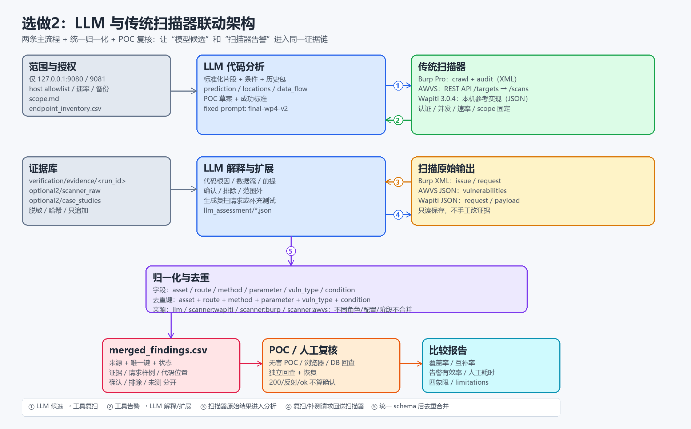

# 联动架构说明



## 组件

| 组件 | 输入 | 输出 |
| --- | --- | --- |
| 范围/清单 | 授权目标、端点、账号 | `scope.md`、`endpoint_inventory.csv` |
| LLM 分析 | 标准化片段、条件、历史包 | prediction、locations、data_flow、POC 草案 |
| 扫描器 | 目标 URL、scope、认证、速率 | Burp XML / AWVS JSON / Wapiti JSON |
| 归一化/去重 | 扫描告警 + LLM finding | `merged_findings.csv` |
| POC/人工复核 | 合并后的候选 | 确认/排除/未测状态、证据 |
| 比较报告 | 覆盖矩阵 + 指标 | `comparison_report.md`、`metrics.csv` |

## 两条主流程

### 流程 A：LLM 先分析 → 工具复扫

1. LLM 读代码，输出候选的 `route/method/parameter/condition/code_location`；
2. 人工/脚本把候选转成扫描种子（URL、方法、参数、无害 payload）；
3. 扫描器按同一 scope/认证/速率复扫；
4. 命中 → 合并为 `llm;scanner`；未命中 → `scanner_not_confirmed`，不直接判 FP；
5. POC/人工复核，写回 `verification_status`。

### 流程 B：工具先发现 → LLM 解释/扩展

1. 扫描器导出 Burp XML/AWVS JSON/Wapiti JSON；
2. 归一化为统一字段（asset/route/method/parameter/vuln_type/severity/request）；
3. LLM 读对应代码，给出根因、数据流、前置条件、范围判断；
4. 状态分为 `confirmed`、`excluded`、`out_of_scope`；
5. 需要时生成补充测试/POC，回写 `merged_findings.csv`。

## 去重

键：

```text
asset + route + method + parameter + vuln_type + condition
```

`condition` 包含角色、security 档位、对象关系、阶段。这样 AUTH-001 的读/写、XSS-001/002/003 的 low/medium/high、CMD-001/002/003 的过滤档位不会被错误合并。

## 人工复核边界

- 扫描器命中不等于确认；必须有同条件 POC/浏览器/数据库回查。
- LLM 解释不等于确认；`model_verdict=确认` 仍要看 `runtime_evidence`。
- 配置告警、范围外发现、未测端点分别记录，不混入目标 TP/FP。
